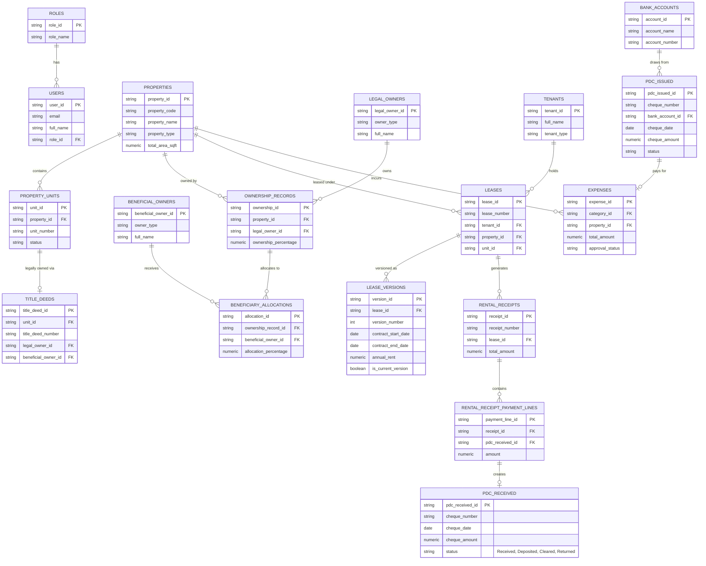

# AIGPMS Database Architecture Design

This document outlines the full database architecture for the AI Powered Gateway Property Management System (AIGPMS). The schema is designed using SQLAlchemy ORM and is fully compatible with PostgreSQL.

The architecture is strictly divided into distinct functional modules, enforcing the business rules defined by the Property Manager (PM) (such as immutable histories, separated PDC instruments, and strict version control).

---

## High-Level Entity Relationship Diagram (ERD)

---

## Module 1: Auth & User Management

Handles authentication, roles, and strict audit logging.

- **`roles`**: Defines user permissions (Admin, PM, Accountant).
- **`users`**: System users linked to roles.
- **`audit_logs`**: Immutable ledger of critical actions performed by users (e.g., changes to financial data, logins).

## Module 2: Property Master & Title Deeds

The foundation of the system. All financial metrics route back to these entities.

- **`properties`**: The core asset (Building, Villa, Land).
- **`property_units`**: Sub-units within a property (Apartment 101, Shop 5).
- **`title_deeds`**: (1-to-1 with property unit) The legal identity, mortgage details, and official ownership identifiers (links to legal and beneficial owners).
- **`property_acquisition_costs`**: Permanent, immutable record of the total cost to acquire the property (Price + Brokerage + DLD). Essential for ROI.
- **`property_valuations`**: Immutable history of market valuations for capital appreciation forecasting.
- **`property_documents`**: Storage for Title Deeds, SPA, Floor plans.

## Module 3: Ownership & Beneficiaries

Separates legal ownership from beneficial (income-receiving) ownership.

- **`legal_owners`**: Master record for entities or individuals that legally own a property.
- **`beneficial_owners`**: Master record for entities or individuals that receive income from a property.
- **`ownership_records`**: Maps a legal owner to a property with a specific percentage (e.g., 50% co-owner).
- **`beneficiary_allocations`**: Maps rental income from an ownership record to a specific beneficial owner's bank account.

## Module 4: Tenant & Lease Management

Implements strict version control so financial history is never overwritten.

- **`tenants`**: Individual or Corporate tenant master records.
- **`leases`**: The container entity linking a tenant, property, and unit.
- **`lease_versions`**: The actual contract. Renewals create *new* versions (e.g., v1 -> v2) instead of updating the old one. Preserves historical rent amounts.
- **`lease_payment_schedules`**: The approved financial baseline for a lease version (e.g., 4 cheques of 25k). PDC receipts are validated against this.
- **`lease_documents`**: Tenancy contracts, Ejari certificates, ID copies.

## Module 5: PDC Received (Income & Collections)

Treats each cheque as an independent financial instrument with its own lifecycle.

- **`rental_receipts`**: The collection event header.
- **`rental_receipt_payment_lines`**: The individual instruments collected in that receipt (Cash, Transfer, or Cheques).
- **`pdc_received`**: The physical cheque record. Tracks holding location, bank submission, and clearing. Statuses: *Received, Deposited, Cleared, Returned, Replaced*.
- **`pdc_received_status_history`**: Immutable log of every status change for a cheque.
- **`cheque_returns`**: Tracks bounced cheques, bank charges, and follow-up actions.
- **`cheque_replacements`**: Links a bounced/cancelled cheque to its new replacement cheque.

## Module 6: PDC Issued (Payments)

Manages company bank accounts and outgoing cheques.

- **`bank_accounts`**: Company bank accounts used for issuing cheques.
- **`cheque_books`**: Registers of cheque books received from the bank.
- **`cheque_leaves`**: Individual cheque leaves (numbers) to prevent skipping or fraudulent issuance.
- **`pdc_issued`**: Issued cheque record paying for expenses, loans, or supplier invoices.
- **`pdc_issued_status_history`**: Immutable log of issued cheque statuses.
- **`authorized_signatories`**: Defines which users can sign cheques and their financial limits.

## Module 7: Finance & Expenses

Tracks all costs, whether general or property-specific.

- **`cost_centres`**: Organizational buckets for general expenses (e.g., IT, Head Office).
- **`expense_categories`**: Hierarchical categorization of costs.
- **`expenses`**: The expense invoice/record. Can be "General" or "Property-Related".
- **`expense_allocations`**: Distributes a single expense across multiple properties based on predefined rules (e.g., split by area, unit count, or flat %).
- **`cashflow_commitments`**: Forward-looking ledger combining upcoming expenses, loan instalments, and outgoing PDCs to fuel the AI Cashflow Predictor.
- **`system_settings`**: Configurable thresholds (e.g., Alert days for PDCs).

## Module 8: Master Data

All dropdowns and reference data in the system are data-driven. No hardcoded enums.

- **`master_banks`**: Global bank registry.
- **`master_communities`**: Valid locations and emirates.
- **`master_emirates`**: Emirates registry.
- **`master_property_types`**: Types of properties allowed.
- **`master_expense_categories`**: Core expense classifications.
- **`master_maintenance_categories`**: Maintenance SLA categories.
- **`master_payment_methods`**: Accepted payment methods.
- **`notification_templates`**: Text/Email templates for alerts (PDC bounces, Expiries).
- **`ai_prompt_templates`**: Pre-canned prompts for the AI Assistant.
- **`approval_limits`**: Defines financial thresholds required for Manager/Director approvals.

---

### Key Architectural Decisions (PM Approved)

1. **Immutable History**: Valuation changes, lease renewals, and cheque status changes NEVER overwrite the previous state. They create new records or version history rows.
2. **Separation of PDCs**: PDCs are isolated instruments, not JSON blobs inside a receipt. This allows independent tracking, banking, and bouncing of a single cheque out of a 4-cheque payment.
3. **Double-Entry Cashflow**: Commitments (`cashflow_commitments`) track incoming vs. outgoing capital independently of whether the physical invoice is paid, enabling real-time future liquidity predictions.
now 